# Architecture

One page. Decisions and their reasons are in [SPEC.md](SPEC.md) section 13.

## The shape

```mermaid
flowchart TB
    subgraph You
        O[Officer at the terminal]
    end
    subgraph "flagbox run (one process)"
        CLI[CLI: find buyer, pick, prompt]
        G[LangGraph agent<br/>SQLite checkpointer]
        LS[LoggedSession<br/>wraps every MCP call]
        LOG[(logs/run_id.jsonl<br/>hash chain)]
    end
    M[Qwen3 8B<br/>Ollama, local]
    subgraph "Our MCP server (child process)"
        T[find_buyer, data_coverage,<br/>fetch_buyer_awards, repeat_winner,<br/>record_finding, draft_memo]
        V[verifier + memo builder]
    end
    SNAP[(data/flagbox.sqlite<br/>read-only snapshot)]
    RS[(data/run_state.sqlite<br/>findings, approvals)]
    DR[drafts/]
    FS[Filesystem MCP server<br/>borrowed, pinned, node]
    FD[filed/]

    O --> CLI --> G
    G <--> M
    G --> LS --> T
    LS --> LOG
    T --> SNAP
    T --> V --> RS
    V --> DR
    G -. "after approval, code only" .-> LS
    LS -. "list_directory, write_file" .-> FS --> FD
```

## The graph, node by node

| Node | Who decides | What it does |
|---|---|---|
| `check_coverage` | code | Calls `data_coverage`. Lists which indicators have enough usable data. Ends the run early (with a memo) if there are no awards or nothing can run. |
| `plan` | model | Chooses which runnable indicators to run and gives a reason for any it skips. A bad plan falls back to "run everything runnable". |
| `investigate` | model, loop | Calls the planned indicator tools (buyer and dates are fixed by the harness and hidden from the model). `record_finding` is offered only after some tool has returned a hit. Limits: 25 tool calls, 15 minutes, two wasted calls in a row ends it. |
| `verify` | code | Re-checks every stored finding against the run's own log and reports hits that got no decision. |
| `draft` | code + model | Builds the memo from the log and stored findings. The model writes only the summary paragraph, which `draft_memo` checks; after two refusals a fixed summary is used. |
| `human_gate` | a person | Contains only `interrupt()`. Resuming repeats no work. |
| `decide` | code | Validates the typed name, the decision and the memo hash; stores the approval (with OS user and the log's head hash). |
| `file` | code | Re-verifies the log, re-hashes the draft against the approved hash, refuses a duplicate filename, calls `write_file`, reads back and re-checks. |

## Trust boundaries

1. **Record text is data.** Titles and names from the source files are flattened, truncated and labelled as data in every tool result. The prompts tell the model to ignore instructions found there.
2. **The model's output is a choice, not text.** It passes a `hit_id`, a severity and a `reason_code`. Claims and explanations are fixed templates written in code. Anything it does write (a summary, a skip reason) goes through fixed wording rules.
3. **The log is the source of truth.** The verifier, the memo builder and the filing step all read the hash-verified log, not the model's account. The server that records findings re-verifies the log's chain on every call.
4. **Writing to `filed/` has one door.** Only the `file` node, only after a decision bound to the memo's SHA-256, only through the borrowed server restricted to `filed/`. The model is offered no filesystem tool and our server exposes none.

## Data flow

`flagbox setup` downloads the PPRA yearly files and records their hashes. `flagbox ingest` streams them once: it drops personal contact data, withholds supplier names without a company marker, keeps only processes with an award and a past closing date, and writes the SQLite snapshot with a `source_ref` (file, line, OCID, portal link) for every row. At run time everything is read from that snapshot through parameterised queries, read-only. Findings, hits, approvals and the drafted memo's hash go to a separate `run_state.sqlite`, so re-ingesting never touches them.

## Adding capability

An indicator is one file plus one config block plus one test; the server registers its tool and `data_coverage` lists it with no change to the graph (see the README). Each indicator ships its own fixed reason wording, with a rule for when each reason is true.
