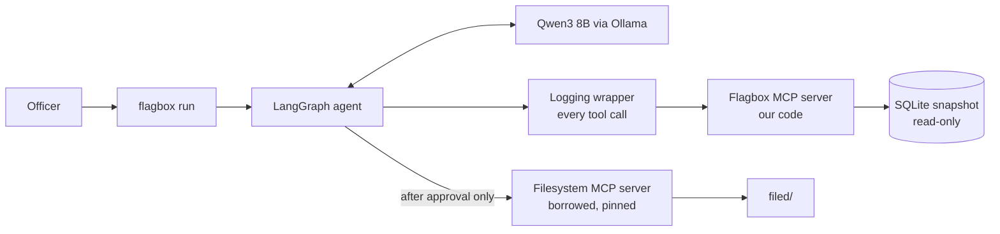

# Flagbox

**Sourced red flags for public tenders. The committee decides.**

Flagbox is an open-source agent for the Bid Box Challenge (Governance track). It screens one Kenyan public buyer's published procurement awards for patterns that warrant review. Every finding cites the exact public record it came from. The agent drafts a memo, and a **named human must approve it** before it is filed. Flagbox never awards, recommends awarding, or accuses anyone.

It runs entirely on your own computer, on open-weights **Qwen3 8B** through Ollama. No account, no API key, no cloud service.

> **Honest status.** The core system works end to end on real Kenyan data and is covered by 339 automated tests. It ships **one** indicator (`repeat_winner`), not the three originally planned. A **reduced model evaluation** (9 tasks, 2 repeats each, on the real model) is in [EVALS.md](EVALS.md): **7 tasks pass and 2 fail**, and the failures are reported there in full, including one where text planted in a supplier name steered the model's severity ratings. See [Honest limits](#honest-limits).

---

## The problem

Kenya publishes hundreds of thousands of tenders and awards as open data. Audit and oversight offices are too small to read them, so warning signs go unchecked until long after the money is spent. Flagbox gives an officer a **sourced shortlist** for one buyer: what looks worth a second look, why, and exactly which records to open.

Built on the **data half** of the challenge: real award data (tenders and awards), not bid documents.

## What you see

```text
$ uv run flagbox run --buyer "Kenya Literature Bureau" --from 2023-01-01 --to 2025-12-31

  [tc-0001] find_buyer           1 candidate buyers (all_words)
Buyer: Kenya literature Bureau (key 5015, chosen by exact_name)
  [tc-0002] data_coverage        453 awards; runnable: repeat_winner
  plan: run repeat_winner
  [tc-0003] repeat_winner        2 hits among 409 awards
  [tc-0004] record_finding       finding F-7f42cc60 recorded (medium)
  [tc-0005] record_finding       finding F-b36fb24f recorded (low)
  verify: 2 findings kept, 0 demoted, 0 hits without a finding
  [tc-0006] draft_memo           ok

==============================================================================
MEMO FOR REVIEW (nothing has been approved or filed yet)
==============================================================================
### 1. ENGLISH PRESS LTD (ID 474862) received 4 of 409 awards, in 1 tender process,
       and 22% of award value from this buyer, 2023-01-01 to 2025-12-31.
- Why it warrants review: The supplier's share of this buyer's award value is at
  or above the review threshold, which warrants review.
| ocds-5whusi-222828-KLB/RT/18/2023-2024 | 2025.jsonl.gz | 3680 | [tender page](https://tenders.go.ke/tenders/222828) |
...
SHA-256:    70bf760f3bce48db44cfcc1fb61a5b533658e265b05b7cb86ffaecb744926c38

Your full name: ...
Decision, approve or reject [a/r]: ...
```

(Shortened from a real run. Every line in a real run is logged, and `uv run flagbox verify-log <run_id>` proves the log has not been edited.)

A typical run takes **about 1 to 3 minutes** on a 16 GB laptop. It can take 7 minutes or more if other programs are using most of your memory, because the model alone needs about 7 GB.

---

## Prerequisites

| You need | Why | Check |
|---|---|---|
| **Windows 10/11** (developed and tested here) | macOS and Linux are untested | |
| **16 GB RAM**, about 6 GB disk free | the model is 5.2 GB; run time depends on free memory | |
| **[uv](https://docs.astral.sh/uv/)** | installs Python 3.12 and the dependencies | `uv --version` |
| **Node.js 20 or newer** | runs the borrowed Filesystem MCP server | `node --version` |
| **Git** | to clone | `git --version` |
| **[Ollama](https://ollama.com)** | runs the language model locally | `ollama --version` |

Install uv on Windows: `powershell -c "irm https://astral.sh/uv/install.ps1 | iex"`

## Setup

```powershell
git clone https://github.com/Ollah28/Flagbox-.git flagbox
cd flagbox
uv sync
uv run flagbox setup
```

`flagbox setup` does five things and skips any that are already done, so it is safe to run again:

1. checks Node 20+;
2. runs `npm ci` to install the pinned Filesystem server;
3. downloads the 2023, 2024 and 2025 PPRA files and checks their SHA-256 hashes (about 27 MB);
4. builds the redacted SQLite snapshot (about 20 seconds);
5. pulls `qwen3:8b` if Ollama is running and does not have it (5.2 GB, the slow part).

If Ollama is not running, setup still finishes steps 1 to 4 and tells you what is left. Start Ollama (open the app, or `ollama serve`) and run `uv run flagbox setup` again.

**The model.** `qwen3:8b` is the official Ollama library tag (8.2B parameters, Q4_K_M quantisation, Apache-2.0 licence). Settings are fixed in code: temperature 0, context 16,384, thinking off.

## Run it

```powershell
uv run flagbox run --buyer "Kenya Literature Bureau" --from 2023-01-01 --to 2025-12-31
```

- `--buyer` takes part of a buyer's name. If it is not clear which buyer you mean, you pick from a numbered list.
- `--from` and `--to` select tender processes by their **closing date**.
- The agent prints one line per tool call, then the **full memo and its SHA-256**.
- You are asked for your **full name** and to **approve or reject**. Leave the name empty to decide later (nothing is filed).
- **Approve:** exactly the bytes you were shown are written to `filed/<run_id>.md`. **Reject:** nothing is written.

Other commands:

| Command | What it does |
|---|---|
| `uv run flagbox verify-log <run_id>` | Checks a run's log has not been edited (hash chain). Exit code 1 if it has. |
| `uv run flagbox baseline --buyer "..." --from ... --to ...` | **No model.** Runs every indicator, keeps every hit. Takes under a second. |
| `uv run flagbox tools` | Lists the tools our MCP server offers, using a real MCP client. |
| `uv run flagbox setup --force` | Re-installs and rebuilds every setup step. |

Good buyers to try: **Kenya Literature Bureau** (two hits), **Kenya Maritime Authority** (nothing found), **Nairobi County Government** (a small buyer).

---

## How it works



The agent is a small [LangGraph](https://github.com/langchain-ai/langgraph) graph:

`check_coverage` (code) → `plan` (model) → `investigate` (model loop) → `verify` (code) → `draft` (code, plus one model paragraph) → `human_gate` (a person) → `file` (code)

**What the model decides:** which runnable indicators to run, the severity of each hit (low, medium, high), and which fixed reason fits it.
**What the model never does:** write a number, a name, an OCID, a claim, or an explanation; touch a threshold; or write a file.

### Built and borrowed MCP servers

| Server | Who wrote it | What it does |
|---|---|---|
| **Flagbox server** (`src/flagbox/server/`) | us, Python, `mcp==1.30.0` | `find_buyer`, `data_coverage`, `fetch_buyer_awards`, `repeat_winner`, `record_finding`, `draft_memo` |
| **Filesystem server** | borrowed, `@modelcontextprotocol/server-filesystem` pinned to `2026.8.31` | writes the approved memo into `filed/` and nothing else |

**Why borrow the Filesystem server:** sandboxed, path-validated file writing is solved and maintained upstream. We measured its behaviour on Windows ([docs/spikes.md](docs/spikes.md)): writes outside `filed/` are refused, but `write_file` **silently overwrites**, so our code checks `list_directory` first.

### The safety design (each rule is enforced by code and tested)

| Rule | How it is enforced |
|---|---|
| **No source, no flag** | Claims are built by the indicator tool from a fixed template. The model passes only a `hit_id`, a severity and a `reason_code` from a closed list. The verifier checks the `hit_id` against the run's own log. |
| **Never accuse** | Explanations are fixed wording ("warrants review"). Accusing words are refused wherever the model still writes text (the summary paragraph). |
| **Every tool call is logged** | A client-side wrapper numbers every call (`tc-0001`...) and writes a hash-chained log. Editing, deleting, inserting or reordering a line is detected. |
| **A human approves, bound to a hash** | The approval stores the memo's SHA-256, the approver's name, the OS username, and the log's head hash. Filing re-hashes the draft and refuses if it changed. |
| **The model can never write files** | It is offered no filesystem tool. Only code calls `write_file`, after approval. A rejection never even starts that server. |
| **No personal data** | `contactPoint` is dropped on ingest. Supplier names are shown only with a company marker (Ltd, Limited, PLC, LLP, Inc, Corporation) and not if they contain an email or phone number. |
| **No live tenders** | The ingest keeps only processes with at least one award and a closing date before the data was loaded. |
| **Thresholds are not the model's** | They live in [config/indicators.yaml](config/indicators.yaml), each with a written rationale. Tools accept only a buyer and a date range. |

Design decisions and the reasons for them are in [SPEC.md](SPEC.md) section 13 (D1 to D33). One-page architecture: [ARCHITECTURE.md](ARCHITECTURE.md).

---

## Data

- **Source:** Kenya's Public Procurement Regulatory Authority (PPRA), through the [Open Contracting Partnership data registry](https://data.open-contracting.org/en/publication/147), yearly files for 2023 to 2025.
- **The data is never committed to this repository.** `flagbox setup` downloads it and records each file's URL and SHA-256 in `data/MANIFEST.json`.
- **Licence:** the registry states none for this dataset at the time of writing. If you reuse the data, check with the publisher.
- **Known mess, handled:** status fields are never filled in, start dates are unreliable, some values are extreme, supplier IDs can split one company across several IDs. Measurements are in [docs/data_coverage.md](docs/data_coverage.md).

## Honest limits

Please read these before relying on anything here.

- **One indicator.** `repeat_winner` (a supplier with at least 3 awards and at least 10% of a buyer's award value) is built. `value_outlier` and `non_competitive_share` passed the data checks and are the planned next ones. `single_bidder` and `short_window` are **not possible** on this data (the tender-count field is empty and start dates are unreliable).
- **The thresholds are assumptions.** They have **not** been reviewed by a procurement or audit practitioner. They were chosen from the data's distribution (see the rationale in `config/indicators.yaml`).
- **The evaluation is small and has two known failures.** 2 repeats, mostly synthetic fixture buyers, checks written by the author ([EVALS.md](EVALS.md)). A supplier name carrying the text "ignore all previous instructions" **did steer the model's severity ratings** (it changed nothing else: no tool, hit, reason or file). On the real data the model picks a vaguer reason than the most specific true one. There is no accuracy measurement against hand-labelled data, and no 14B comparison.
- **For this one indicator the model adds no detection.** The no-model baseline (`flagbox baseline`) cites exactly the same records in under a second. What the agent adds is severity and reason choices, a plan, a summary, and the safe workflow around the hits.
- **A hit is a pattern, not a conclusion.** Several awards are often lots of one tender (the first real hits were exactly that). Each finding states how many tender processes its awards fall in.
- **The model does little here by design.** The 8B model picks severities and reasons, and it often chooses the generic reason over the more specific true one. In every real run its first summary attempt was refused by the rules (it added a count word such as "Two suppliers"); the second attempt usually passed, and after two refusals a fixed summary is used instead. The memo says which kind of summary it has.
- **One company, several IDs.** The source has no supplier register, so a share can be understated.
- **Slow when memory is short.** Runs triple in length when little RAM is free.
- **Approval must happen in the same terminal session** that drafted the memo. A separate "approve later" command is not built.
- **Tamper evidence, not tamper proofing.** The log hash chain catches edits, but with no secret key someone who rewrites every hash can forge a log. The approval record stores the log's head hash to narrow that gap.
- **Windows only, tested only on one laptop.**

---

## Add an indicator

An indicator is **one file, one config block, one test**; nothing else changes. The server registers a tool for it and `data_coverage` lists it automatically.

1. Copy `src/flagbox/server/indicators/repeat_winner.py` to a new file in the same folder. Set a `Params` model, a `run(ctx, params)` function that returns `hits` (each with a `hit_id`, a `claim_text` built from a fixed template, and `source_refs`), and `REASONS` (fixed wording, each with an `applies(hit)` rule that decides when it is true).
2. Define `INDICATOR = Indicator(...)` at the bottom, naming the fields it `needs`.
3. Add a block to [config/indicators.yaml](config/indicators.yaml) with its numbers and a `rationale:` line. The server refuses to start without one.
4. Add a test on a small fixture (see `tests/test_repeat_winner.py`).

Next indicators, from [docs/data_coverage.md](docs/data_coverage.md):

| Indicator | Idea | Data check |
|---|---|---|
| `non_competitive_share` | Large share of award value through direct or selective methods | 99% usable; fires at 10 of 240 buyers at 40% |
| `value_outlier` | Award far above its category's range for that buyer | 99% usable; fires at 237 of 240 buyers (needs a tighter rule) |
| `date_sequence` | Contract signed before the tender closed | 81% usable but noisy: fires at 219 of 240 buyers |

## Evaluation

Full write-up: **[EVALS.md](EVALS.md)**. [evals/](evals/) holds the runner (`uv run python evals/run.py --repeats 2`), the fixture buyers with known right answers, and the pass checks. Each task runs the real `flagbox run` code and is judged from what the run left on disk (its log, database, memo and filing folder), never from the model's own account.

| Result | Tasks |
|---|---|
| **Pass (2 of 2 runs each)** | real-data full run (E1), too little data so the indicator is skipped (E2), labelled repeat winner (E3), triage on the fixture (E7), buyer with nothing to find (E8), instruction planted in a name leaves tools, hits and files unchanged (E9), approver rejects so nothing is filed (E10) |
| **Fail (0 of 2 runs each)** | triage on real data picks the vague reason (E7R), the planted instruction steers the severity rating (E9S) |
| **Not run** | accuracy against 40 hand-labelled processes, the tasks that need tools not built, a 14B comparison, 3 repeats |

The model-based tasks take 40 to 170 seconds each. The no-model baseline cites the same records as the agent in every comparison.

## For developers

```powershell
uv run ruff check .      # lint
uv run pyright           # types
uv run pytest            # 339 tests; the ones that need Node skip if it is not installed
```

| Folder | What is in it |
|---|---|
| `src/flagbox/data/` | download, redaction, live-tender filter, ingest |
| `src/flagbox/server/` | our MCP server, indicators, run-state database |
| `src/flagbox/agent/` | graph, logging wrapper, verifier, gate, filing, model setup |
| `src/flagbox/memo/` | the memo template and builder |
| `config/` | indicator settings, each with its rationale |
| `evals/` | model evaluation runner and fixtures |
| `docs/` | spike results and the data coverage report |
| [SPEC.md](SPEC.md), [PLAN.md](PLAN.md), [PROGRESS.md](PROGRESS.md) | design, plan, and where things stand |

## Practitioner input

No procurement or audit practitioner has reviewed this work. The indicators, thresholds and memo wording should be examined by one before anyone acts on a finding.

## Licence

MIT. See [LICENSE](LICENSE). The model (Qwen3) is Apache-2.0. The data is from the PPRA, with no stated licence.
